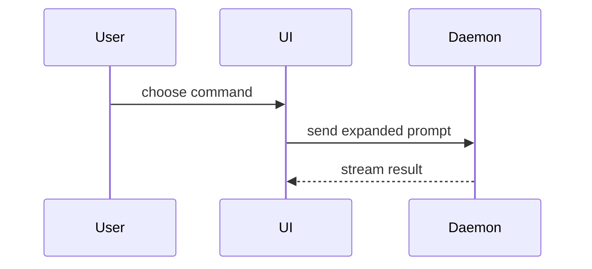

Help the user understand the current topic of conversation visually. Skip the preamble and keep prose brief. Pick the smallest view that makes the key point clear.

- Show logic or an algorithm as pseudocode:

```text
on(save)
  if content is unchanged
    return cached result
  write new content
  return fresh result
```

- Show runtime control flow as a call tree:

```text
run_import
  fetch_pages
    refresh_session
  normalise
  post_transactions
```

- Show file responsibility or a broad refactor as a shallow file tree:

```text
src/
├── commands/       # parses user actions
├── sessions/       # owns session state
└── transport/      # sends API requests
```

- Show what owns or depends on what as a resource tree, with only the boundaries that matter (namespace, project, who creates it):

```text
Application app            (argocd)
  Deployment app
    Secret app-db          (sealed)
    PVC app-data
  HTTPRoute app -> Gateway internal
```

- Show a request or data path as one line of hops, with a note under the hop the point is about:

```text
client -> edge -> gateway -> HTTPRoute -> Service -> pod
                  └ TLS ends here
```

- Compare options or states in a small table, one row per option and only the columns that differ.

- Use `diff` when the point is what changes and the surrounding shape already exists. Match the diff shape to the topic.

For a file-layout change:

```diff
 src/
 ├── commands/
+│   └── show-me.ts       # expands the slash command
 ├── sessions/
-└── transport.ts
+└── transport/
+    ├── client.ts
+    └── stream.ts
```

For a call-tree change:

```diff
 run_import
   fetch_pages
+    refresh_session
   normalise
-  post_transactions
+  post_transactions
+    mark_page_done
```

For a state or control-flow change:

```diff
 on(save)
-  write content
+  if content is unchanged
+    return cached result
+  write new content
+  invalidate cache
```

For a resource or path change:

```diff
-client -> gateway -> Service -> pod
+client -> edge -> gateway -> Service -> pod
```

- Show the whole block when most of it is new, when omitted context would hide ownership or order, or when the user needs a copyable target shape.

- Use Mermaid only in text that will be rendered: a PR body, an issue, a doc on GitHub. A terminal shows it as source, so in a chat reply use one of the text views above.



- For a layout, a state comparison or a concept too dense for the views above, write one focused HTML file (a diagram, an infographic or a short slide deck, whichever fits the point). Use real labels and data, and support desktop and mobile. Don't try to open it: the session may be on a headless box. Publish it as an Artifact when that tool is available and the repo's rules allow the content to leave the repo; otherwise save it in the repo or the scratchpad and give the full path.

### Guidance

Place each visual next to the short text it supports. Keep only the calls, files, resources, states and boundaries needed to answer the user's current question, or the options that resolve the current discussion point.

You may use one of these or several; it is unlikely you will use all of them. Use your judgement and don't overwhelm the user.
